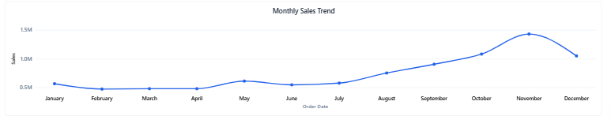
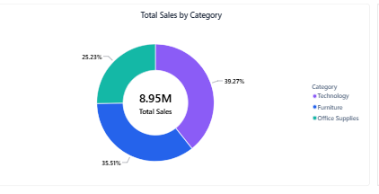
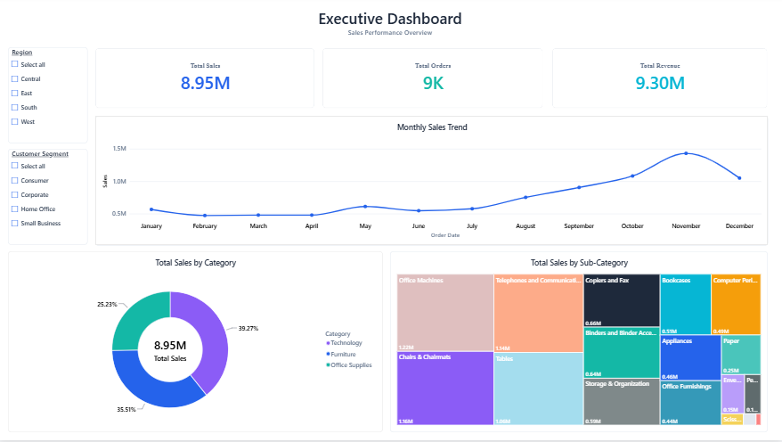

# Executive Sales Performance Dashboard

An interactive **Power BI dashboard** designed to provide a clear overview of sales performance through key business metrics, monthly trends, category comparisons, and sub-category analysis.

## Project Overview

The Executive Sales Performance Dashboard brings important sales insights into one view. It helps users explore overall performance, compare product categories, and identify monthly sales patterns using interactive report filters.

## Dashboard Preview

### Executive Overview
The dashboard presents headline KPIs alongside a monthly sales trend and category-level breakdowns.

### Sales by Category
A donut chart compares the contribution of Technology, Furniture, and Office Supplies to total sales.

### Sales by Sub-Category
A treemap provides a compact comparison of sales across product sub-categories.

## Key Metrics

| Metric | Dashboard Value |
| --- | ---: |
| Total Sales | 8.95M |
| Total Orders | 9K |
| Total Revenue | 9.30M |

*Values shown are those displayed in the current dashboard. Confirm the metric definitions and formatting against the source report before using them in formal business reporting.*

## Features

- **Executive KPI cards** for a quick performance overview.
- **Monthly sales trend** to compare sales across the year.
- **Category analysis** across Technology, Furniture, and Office Supplies.
- **Sub-category treemap** to compare product-level groupings.
- **Interactive filters** for region and customer segment.
- **Single-page overview** that brings several views together for easier analysis.

## Tools & Technologies

- **Microsoft Power BI** — dashboard design and data visualization
- **Microsoft Excel** — source dataset
- **Power Query / data modeling** — used as part of the Power BI workflow, where applicable

## Files in This Repository

| File | Description |
| --- | --- |
| `Executive Sales Performance Dashboard.pbix` | Power BI report file; open with Power BI Desktop |
| `data file.xlsx` | Excel dataset used for the project |
| `line.png` | Monthly sales trend screenshot |
| `pi.png` | Sales by category screenshot |
| `font.png` | Sales by sub-category screenshot |
| `heat.png` | Additional dashboard visual screenshot |

## How to Open the Dashboard

1. Clone or download this repository.
2. Install [Microsoft Power BI Desktop](https://powerbi.microsoft.com/desktop/).
3. Open `Executive Sales Performance Dashboard.pbix`.
4. If Power BI asks for the source file, select `data file.xlsx` and update the data source path if needed.
5. Refresh the data if required, then use the report filters to explore the dashboard.

## Insights to Explore

- How sales change from month to month.
- Which product category contributes the largest share of total sales.
- How individual sub-categories compare in sales.
- How results differ by region and customer segment.

## Project Purpose

This project demonstrates practical skills in business intelligence, KPI reporting, and data visualization. It turns sales data into a visual summary intended to support faster exploration and better-informed decisions.

## Author

**Mubashra Rizwan**

GitHub: [@mubashrarizwan](https://github.com/mubashrarizwan)

---

If you find this project useful, feel free to ⭐ the repository.
